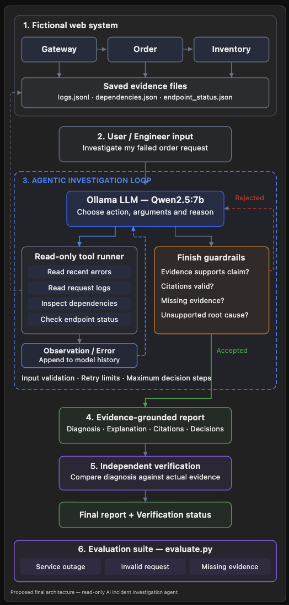

# API Incident Diagnosis Agent

A Python agent that investigates failed order requests from saved logs and simulated service data. It follows a request ID through Gateway, Order, and Inventory, cites the records that support its conclusion, and names the next record to look for when evidence is missing. Run the agent from the terminal or follow its decisions in the Streamlit dashboard.

Built by Ramya Karuthappandian and Akassh Paramasivan as a four-week project.

## 1. Set up the project

If you already have the repository, open it in your terminal and start with Ollama setup. Otherwise, clone it:

```sh
git clone https://github.com/AkasshP/api-incident-diagnosis-agent.git
cd api-incident-diagnosis-agent
```

Run all remaining commands from the repository root. Python 3.11 or later is recommended. The CLI, evaluator, and regression tests use the Python standard library. The Streamlit dashboard adds the dependency listed in [requirements.txt](requirements.txt).

Install [Ollama](https://ollama.com/) if needed. If no Ollama server is running, start it in a separate terminal:

```sh
ollama serve
```

From the repository terminal, download the model and confirm it appears in the installed list:

```sh
ollama pull qwen3:8b
ollama list
```

## 2. Run the three saved incidents

```sh
python3 llm_agent.py incidents/invalid_request request-100
python3 llm_agent.py incidents/service_outage request-200
python3 llm_agent.py incidents/insufficient_evidence request-123
```

Each linked fixture already contains the request logs, dependency map, and saved health checks.

| Saved incident | Request ID | Expected result |
|---|---|---|
| [Invalid request · HTTP 400](incidents/invalid_request/) | `request-100` | `invalid_request`. Gateway event `E11` identifies the missing `item_id`. The agent can finish at Gateway. |
| [Inventory outage · HTTP 504](incidents/service_outage/) | `request-200` | `inventory_failure`. Order timeout `E21` and matching Inventory handler error `E22` point to Inventory as the likely failure location. Nearby probes `HC17` and `HC18` provide context. |
| [Insufficient evidence · HTTP 504](incidents/insufficient_evidence/) | `request-123` | `insufficient_evidence`. `E31` confirms the Order timeout. The agent asks for a matching Inventory handler event. |

The terminal shows decisions as they happen, followed by the JSON report. Check `outcome`, `citations`, and `verification.verified`. For the third case, `verified: true` confirms that the available evidence supports leaving the failure location unresolved.

## 3. Open the Streamlit dashboard

Optional. Keep Ollama running. On macOS or Linux, create and activate a virtual environment, then install Streamlit and start the dashboard. If your environment is already active, start at the install command.

```sh
python3 -m venv .venv
source .venv/bin/activate
python3 -m pip install -r requirements.txt
python3 -m streamlit run streamlit_app.py
```

Open the dashboard at [localhost:8501](http://127.0.0.1:8501). Select **Demo API**, pick a scenario, and click **Send request**. For a failed response, click **Investigate**. Select a trace node to see the tool arguments and returned records. Open **Cited evidence** to review the timeline.

The demo API generates new request and evidence IDs for each run. For a custom endpoint, supply a local evidence folder and a matching request ID to investigate a failure.

## 4. Run the tests and evaluator

```sh
python3 -m unittest discover -v
python3 evaluate.py
python3 evaluate.py --llm
```

The first command runs 30 tests without Ollama. The second runs ten baseline checks without Ollama. The third adds seven live Ollama cases, for 17 checks. The [evidence-removal fixture](tests/fixtures/outage_evidence_removed/) checks that the diagnosis returns to insufficient evidence when the Inventory handler error and readiness timeouts are removed. See the [recorded evaluation](results/evaluation_results.json).

[`tests/test_evidence_selection.py`](tests/test_evidence_selection.py) checks which records each tool returns for every incident. Each incident mixes the records that matter with decoys: other requests' errors, non-failure events for the same request, probes one second outside the 300-second window, probes of the wrong service, and extra routes. The tests confirm that every tool returns only this request's records, that decoys are never cited, that an early finish lists the specific checks still needed, and that a wrong outcome is rejected with the supported one. Five extra fixtures in [`tests/fixtures/`](tests/fixtures/) cover a Gateway-to-Order timeout, timeouts down the whole chain, probes at the window edges, a route map that disagrees with the logs, and corrupt log lines.

## How the agent works

API Gateway validates `POST /orders`, Order Service handles the request, and Inventory Service reserves stock. The project represents these services through saved evidence. Streamlit can also send requests to a local simulator that produces fresh evidence for the same workflow.

1. [`llm_agent.py`](llm_agent.py) validates the incident folder and request ID, then asks Ollama for an action.
2. [`tools.py`](tools.py) reads the requested evidence. The result or error goes back to the model. [`guardrails.py`](guardrails.py) checks tool arguments and rejects a finish if more evidence is needed or the proposed outcome is unsupported.
3. [`report_builder.py`](report_builder.py) builds the timeline and citations from observed records. [`verifier.py`](verifier.py) rereads the saved files and checks the report. An unverified CLI run prints reasons in `verification.problems` and exits with status 1.



The diagram shows the investigation flow. The running model defaults to `qwen3:8b` in [config.json](config.json). Use `--model` to select a different installed Ollama model.

## Repository layout

Start with [`investigate()`](llm_agent.py#L87) to follow one request through the agent. The loop calls the evidence readers in [`tools.py`](tools.py), validates proposed actions and finishes in [`guardrails.py`](guardrails.py), and builds the report from observed records in [`report_builder.py`](report_builder.py). [`verifier.py`](verifier.py) checks the report against a fresh read of the saved bundle.

The terminal and Streamlit dashboard call the same investigation function. [`tests/test_llm_agent.py`](tests/test_llm_agent.py) exercises the loop with controlled model replies, so students can trace a rejected finish or retry without running Ollama.

| Path | Purpose |
|---|---|
| `llm_agent.py` | Ollama decision loop, retry limits, and CLI |
| `tools.py` | Read-only recent errors, request logs, dependencies, and health checks |
| `guardrails.py` | Input, tool argument, and finish validation |
| `report_builder.py` | Diagnosis, timeline, and citations from observed evidence |
| `verifier.py` | Independent comparison against a fresh read of the evidence |
| `config.json`, `requirements.txt` | Runtime defaults and Python dependency information |
| `incidents/` | Service outage, invalid request, and insufficient-evidence bundles |
| `evaluate.py`, `tests/`, `results/` | Evaluation, regression checks and evidence-removal fixture, and recorded results |
| `docs/diagrams/architecture.png` | Final architecture diagram |
| `streamlit_app.py` | Streamlit request form and investigation controls |
| `dashboard/` | HTTP client, demo endpoint, and response and trace views |
| `support/` | Baseline CLI, recent-request manifest, Telemetry Advisor, and team contributions |

## Evidence file formats

Point the CLI at a folder containing the evidence files below. Use timezone-aware ISO 8601 timestamps such as `2026-11-23T14:00:00Z`. By default, a health check can be up to five minutes before or after the Order timeout.

| Evidence | Format |
|---|---|
| `logs.jsonl` | One event per line with `event_id`, `timestamp`, `request_id`, `service`, `event_type`, and `details`. Use `API Gateway`, `Order Service`, and `Inventory Service` as service names. |
| `dependencies.json` | A JSON object mapping each calling service to its route-to-downstream map, for example `{"API Gateway":{"POST /orders":"Order Service"},"Order Service":{"POST /orders":"Inventory Service"}}`. |
| `endpoint_status.json` | An array of checks with `check_id`, `checked_at`, `target_service`, `observed_from`, `path`, and `result`. Set `result` to `timeout` for a timed-out probe. |

For Gateway validation, use `event_type: validation_error` with `details.missing_field`. For a Gateway or Order timeout, use `event_type: downstream_timeout` with `details.downstream_service` and `details.route`. For the matching Inventory handler error, use `event_type: handler_error`.

The report's `outcome` is `invalid_request`, `inventory_failure`, or `insufficient_evidence`. Each timeline entry names its evidence ID, and `tool_trace` records the calls in execution order. Unresolved reports include `next_record`. Read and parse failures appear in `warnings` alongside any diagnosis the available evidence supports.

## Optional CLI commands

The rule-based CLI and recent-request browser run without Ollama:

```sh
python3 -m support.agent incidents/insufficient_evidence request-123
python3 -m support.agent recent support/recent.json --select 1
```

The recent-request command selects the newest saved request with `--select 1`. Manifest paths are relative to the manifest directory.

### Optional offline replay

The Telemetry Advisor is an optional command in the rule-based CLI. It compares which single extra observation would distinguish two saved scenarios. In the included replay, `handler_entered` scores 1, while the Gateway timeout and readiness check each score 0.

```sh
python3 -m support.agent advisor incidents/insufficient_evidence request-123 support/replay/replay.json \
  --missing-observation inventory_handler_entry --budget 1
```

## Team contributions

- **Akassh Paramasivan** implemented the baseline CLI and evidence tools, hardened the agent's input validation, retry limits, finish checks, report generation, and verifier, and built the Streamlit dashboard with demo and custom requests, request history, a clickable investigation trace, and a cited evidence timeline.
- **Ramya Karuthappandian** built the saved incident bundles, evidence-removal fixture, offline replay data, and evaluator. She also implemented the first Ollama investigation loop and created the original architecture diagram.

See [individual contributions](support/CONTRIBUTIONS.md) and the [recorded evaluation](results/evaluation_results.json).
