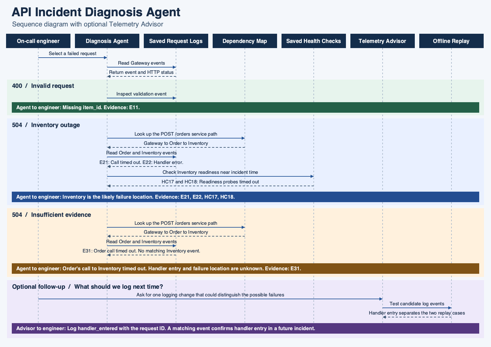
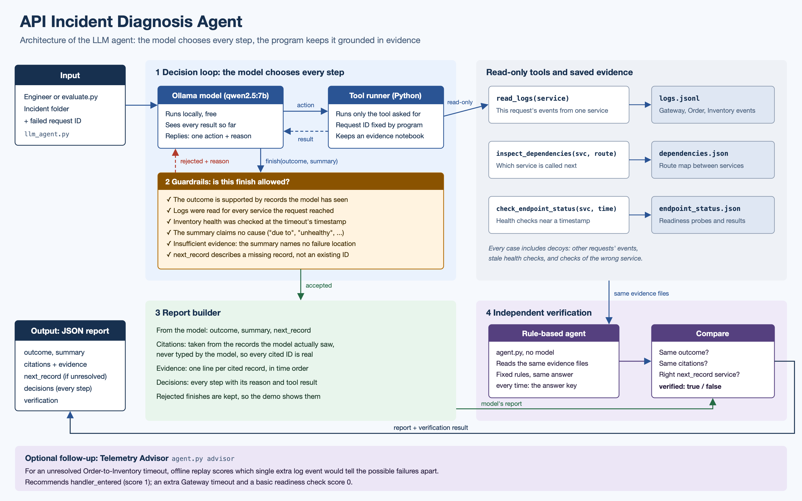

# API Incident Diagnosis Agent

A small Python CLI for answering a practical question after a failed API request: where did it go wrong, and what evidence do we have? Give it an incident folder and a request ID. It follows that request through the saved logs, cites what it finds, and tells you which record to look for next if the trail goes cold.

Built by Ramya Karuthappandian and Akassh Paramasivan as a four-week project.

## How a request moves through the system

The API Gateway validates `POST /orders` and forwards it to the Order Service. Order asks the Inventory Service to reserve stock. The agent investigates these three fictional services by reading saved files locally.



The agent starts with the Gateway logs. A validation error with a missing field is enough to explain the rejection. For a timeout, the agent checks the route map and follows the call recorded in the logs, looking for the same request ID in the downstream service. An Order-to-Inventory timeout also prompts a lookup for nearby readiness checks. Each readiness timeout describes what the probe observed from its own vantage point.

## What the diagnosis looks like

Each report includes a short timeline with evidence IDs and a trace of the files the agent consulted. These are the three demo cases.

| Demo | Expected report |
|---|---|
| Invalid request · HTTP 400 | Missing `item_id`. Cite Gateway validation event `E11` and finish without a downstream lookup. |
| Inventory outage · HTTP 504 | Inventory is the likely failure location. Cite Order's call timeout `E21` and Inventory's matching handler error `E22`. Cite readiness timeouts `HC17` and `HC18` as supporting observations. The underlying cause remains undetermined. |
| Insufficient evidence · HTTP 504 | Order timed out waiting for Inventory. Cite `E31` and request an Inventory-side event for the same request. |

## Run locally

Use Python 3.9 or later. The CLI prints a JSON report and uses only the standard library.

```sh
python3 agent.py path/to/incident request-123 --health-window-seconds 300
```

### Run the LLM agent

`llm_agent.py` uses a free local model through [Ollama](https://ollama.com). The model decides which tool to call at each step, when to stop, and what the outcome is. It prints each decision and its reason as it goes.



```sh
ollama pull qwen2.5:7b
python3 llm_agent.py incidents/inventory-outage request-200
```

The program only runs the tools the model asks for. A finish is rejected, and the model keeps investigating, if the evidence it has seen does not support the outcome, if it skipped the logs of a service the request reached, or if its summary claims a cause for a timeout or failure. Citations come from the records the model actually saw. The report's `verification` field compares the model's answer with the rule-based diagnosis from `agent.py`. Use `--model` to try another Ollama model.

### Run the evaluation

```sh
python3 evaluate.py        # rule-based agent and replay advisor
python3 evaluate.py --llm  # also the LLM agent
```

Sample incidents are in `incidents/`, replay scenarios in `replay/`, and the latest results in `evaluation/results.md`.

Point the CLI at a folder containing the evidence files below. Use timezone-aware ISO 8601 timestamps such as `2026-11-23T14:00:00Z`. By default, a health check can be up to five minutes before or after the Order timeout.

| Evidence | Format |
|---|---|
| `logs.jsonl` | One event per line with `event_id`, `timestamp`, `request_id`, `service`, `event_type`, and `details`. Use `API Gateway`, `Order Service`, and `Inventory Service` as service names. |
| `dependencies.json` | A JSON object mapping each calling service to its route-to-downstream map, for example `{"API Gateway":{"POST /orders":"Order Service"},"Order Service":{"POST /orders":"Inventory Service"}}`. |
| `endpoint_status.json` | An array of checks with `check_id`, `checked_at`, `target_service`, `observed_from`, `path`, and `result`. Set `result` to `timeout` for a timed-out probe. |

For Gateway validation, use `event_type: validation_error` with `details.missing_field`. For a Gateway or Order timeout, use `event_type: downstream_timeout` with `details.downstream_service` and `details.route`. For the matching Inventory handler error, use `event_type: handler_error`.

The report's `outcome` is `invalid_request`, `inventory_failure`, or `insufficient_evidence`. Each timeline entry names its evidence ID, and `tool_trace` records the calls in execution order. Unresolved reports include `next_record`. Read and parse failures appear in `warnings` alongside any diagnosis the available evidence supports.

### Browse recent failed requests

```sh
python3 agent.py recent recent.json
python3 agent.py recent recent.json --select 1
```

The first command lists rows newest first and prompts for a row in an interactive terminal. The second opens that row's evidence bundle directly and prints its diagnosis. Paths in `incident_folder` are relative to the manifest directory unless absolute. Supply the request's actual HTTP status in the manifest.

```json
{
  "requests": [
    {
      "timestamp": "2026-11-23T14:00:00Z",
      "route": "POST /orders",
      "http_status": 504,
      "request_id": "request-123",
      "incident_folder": "incidents/missing-inventory"
    }
  ]
}
```

If the only matching record is the Order timeout, the diagnosis looks like this.

```json
{
  "outcome": "insufficient_evidence",
  "summary": "Order Service timed out waiting for Inventory Service.",
  "next_record": "An Inventory Service handler event for request request-123.",
  "citations": ["E31"]
}
```

### Run the Telemetry Advisor

```sh
python3 agent.py advisor incidents/missing-inventory request-123 replay/replay.json \
  --missing-observation inventory_handler_entry --budget 1
```

If Order timed out and the evidence leaves Inventory handler entry unresolved, the advisor compares what one extra event would reveal across saved scenarios. It returns the original diagnosis alongside the replay results. Keep replay data in its own file with these two fields.

- `candidates` contains objects with `event_name`, `instrumentation_location`, and `expected_benefit`.
- `scenarios` contains objects with a unique `id`, a `visible_records` array, and a `candidate_records` object. Map every candidate name to an array of records that candidate would expose in the scenario. Use an empty array when it emits nothing.
- Use comparable record objects across scenarios. Omit scenario-specific metadata such as synthetic IDs and timestamps unless it represents a difference the investigator could use. For each candidate, compare its projected records only across pairs with identical baseline records. Every pair the candidate separates adds one point. Candidates are scored independently under the one-event budget.

With two sample scenarios that share the same visible timeout, an extra Gateway timeout and basic readiness check each score 0 if their records are identical in both scenarios. A request-correlated `handler_entered` event scores 1 if only the scenario that reaches Inventory emits it. This excerpt comes from a run with the saved replay scenarios.

```json
{
  "baseline_indistinguishable_pairs": 1,
  "recommended_events": ["handler_entered"],
  "top_score_ties": []
}
```

The full output includes candidate scores, instrumentation locations, expected benefits, and remaining uncertainty. Replay assumes candidate events would be observed reliably. It cannot establish what happened in the original incident.

## TODOs by owner

### Akassh Paramasivan — Agent implementation

#### CLI and evidence tools

- [x] Add CLI arguments for the incident folder and request ID.
- [x] Implement read-only log, dependency map, and health-check readers.
- [x] Filter request events by request ID and service, and health checks by service and incident-time window.

#### Investigation and reporting

- [x] Implement evidence-driven tool selection for validation errors, downstream timeouts, and missing records.
- [x] Build the report with outcome, likely failure location or invalid field, timeline, citations, and tool trace.
- [x] Handle missing or unreadable evidence and document the command for running the finished CLI locally.

#### Demo integration

- [x] Run the CLI against Ramya's fixtures and resolve any file schema, route, or event-name mismatches.
- [x] Add a recent failed-request list that shows route, HTTP status, and request ID. Selecting a row should open the matching evidence bundle. Keep the existing CLI arguments available.

#### Telemetry Advisor and offline replay

- [x] Add an optional advisor command for an unresolved Order-to-Inventory timeout. Pass in the missing observation and a one-event budget.
- [x] Build an offline replay runner that reads Ramya's saved scenarios and projects the records each candidate event would expose.
- [x] Score each candidate by the number of previously indistinguishable scenario pairs it separates. Report the score and any ties.
- [x] Print the candidate's event name, instrumentation location, expected benefit, and remaining uncertainty. Keep the original incident diagnosis unresolved.
- [x] Verify the documented diagnosis and advisor sample outputs against Ramya's fixtures after integration.

### Ramya Karuthappandian — Incident evidence and evaluation

#### Service map and diagnosis fixtures

- [ ] Verify the Gateway, Order, and Inventory route map against the CLI's supported schema and document the shared event fields.
- [ ] Create the HTTP 400 fixture with Gateway event `E11` identifying a missing `item_id`.
- [ ] Create the HTTP 504 outage fixture with Order timeout `E21`, matching Inventory handler error `E22`, and readiness timeouts `HC17` and `HC18`.
- [ ] Create the HTTP 504 insufficient-evidence fixture with an Order-to-Inventory timeout and no matching Inventory event or relevant readiness check.
- [ ] Include an unrelated request event and a stale readiness check to verify request and time filtering.

#### Offline replay fixtures

- [ ] Create two synthetic scenarios with identical visible timeout logs. In one, the request never enters Inventory. In the other, the handler starts and a response never reaches Order.
- [ ] Define candidate observations for an extra Gateway timeout log, a basic readiness check, and Inventory's request-correlated `handler_entered` event.
- [ ] Save simulator ground truth and candidate observations separately from the request evidence. Document the assumption that replay observes candidate events reliably.

#### Evaluation and results

- [ ] Define expected outcomes, supported evidence citations, and expected tool calls for the three required incidents.
- [ ] Evaluate that the invalid request stops at Gateway and the missing-evidence case reports the attempted Inventory call without claiming handler entry.
- [ ] Remove `E22`, `HC17`, and `HC18` from a copy of the outage fixture. Verify the diagnosis changes to insufficient evidence while still citing `E21`.
- [ ] Verify the two replay cases look identical with existing observations and that `handler_entered` separates them in replay. Record actual candidate scores and any mismatches.

### Shared — Integration and delivery

- [ ] **Week 1** — Review the architecture and agree on filenames, event types, evidence IDs, and report format.
- [ ] **Week 2** — Integrate the three diagnosis fixtures and verify the CLI can run all cases locally.
- [ ] **Week 3** — Run the evaluator, evidence-removal test, and offline replay. Review each other's work and record expected versus actual results.
- [ ] **Week 4** — Update the README and sequence diagram, rehearse the three required demo cases and optional advisor follow-up, and publish the runnable repository and evaluation results.
- [ ] Add individual entries to `CONTRIBUTIONS.md` describing completed work and linking to relevant files or commits.
